# Executive Summary

We propose a **shared codebase workshop** for a 90-minute video call, where all developers work on the same repository to (A) **explore and fix** a bug in unknown code and (B) **design and implement** a small new feature. The goal is to compare how each participant uses AI agents in their workflow: how they prompt, verify, and decide on code changes, rather than which tool “wins.” We provide **three concrete candidate projects** (two illustrative and one existing) that fit the criteria. For each, we describe the repo, the bug to reproduce, a failing test, the feature to add, and the expected time. We include a **branch plan with exact commands**, example prompts, and a **facilitator guide** (agenda, rules, registration, discussion questions, rubric) to run the session smoothly. 

All candidates are CLI or API-based projects using SQLite or in-memory DB, with minimal dependencies and automated tests (pytest or Jest). We ensure each repo can be cloned and run locally without credentials. The workflow is: introductions → exploration and bug fix (25m) → new feature (25m) → presentations and debate (30m). Prompts focus on code exploration (“Where is task filtering implemented?”), planning, implementation, and verification. 

We cite the **kanban-tui** project as an example of a Python CLI task manager using SQLite. For Node, we design a comparable sample repository. We include links to the actual **kanban-tui** repo and explain how it fits. Other candidates are detailed scaffolds (with file layouts and test code snippets) so the facilitator can set up the workshop repo. The report ends with a **timeline diagram** of the session and a rubric to evaluate workflows (not models). 

# Candidate Projects Overview

| Candidate | URL or Repo (prepared)                       | Language | Summary                                                                                         | Bug to Fix                                                | Failing Test Snippet                   | New Feature                               | Est. Time (fix / feature) | Setup Checklist                       |
|-----------|----------------------------------------------|----------|-------------------------------------------------------------------------------------------------|-----------------------------------------------------------|----------------------------------------|-------------------------------------------|---------------------------|---------------------------------------|
| **A. kanban-tui** | [kanban-tui on GitHub](https://github.com/Zaloog/kanban-tui) | Python   | Terminal Kanban task manager (TUI) using **SQLite** (default). Includes CLI, tasks, dependencies, etc. Has tests in `tests/`. | *Task with incomplete dependency appears in “Ready” list.*<br>Investigate dependency logic and fix it. | **pytest** example:  

```python
# in tests/test_filter.py
def test_ready_excludes_blocked_tasks(tmp_path, runner):
    # Setup: task A depends on task B, but B is unfinished.
    runner.invoke(cli, ['init'])
    runner.invoke(cli, ['add', '--title', 'B'])
    runner.invoke(cli, ['add', '--title', 'A', '--depends-on', '1'])
    result = runner.invoke(cli, ['list', '--ready'])
    assert 'A' not in result.output  # A should *not* be ready
``` | *Add an `--overdue` filter*: show only tasks whose due_date is past. E.g. tasks with past due dates and not done. Must integrate with existing filters and tests. | ~25m fix / 20m feature | - Clone kanban-tui repo (see [Kanban TUI](https://github.com/Zaloog/kanban-tui))<br>- Install deps: `pip install -r requirements.txt`<br>- Prepare a database: `kanban-tui init` or provided sample DB<br>- Confirm `pytest` passes before fix. |

| **B. TaskMaster-Python (workshop)** | *Prepared example repo* (see file listing below) | Python   | Simple CLI “TaskMaster” managing tasks in SQLite. Commands: `add`, `list`, `complete`. Includes pytest tests in `tests/`. Tables: `tasks(id,title,done,due_date)`. | *Completed tasks still appear in list.* After marking done, tasks should not show in default `list`. Fix logic. | **pytest** example:  

```python
# tests/test_list.py
def test_list_excludes_done(monkeypatch, capsys):
    runner = CliRunner()
    runner.invoke(cli, ['init'])
    runner.invoke(cli, ['add', 'TestTask'])
    runner.invoke(cli, ['complete', '1'])
    result = runner.invoke(cli, ['list'])
    assert 'TestTask' not in result.output  # done task should not appear
``` | *Add an `--overdue` flag*: the `list` command should accept `--overdue` to list tasks past due_date and not done. New tests should cover due_date filtering. | ~15m fix / 20m feature | - Clone or use prepared `taskmaster-py` repo (see file list below).<br>- Install deps: `pip install -r requirements.txt` (e.g. Click, SQLite3).<br>- Initialize DB: `taskmaster init --db db.sqlite` or similar.<br>- Run `pytest` to confirm failing test. |

| **C. TaskMaster-Node (workshop)** | *Prepared example repo* (see file listing below) | JavaScript (Node.js) | Node CLI “TaskJS” using yargs and SQLite (`better-sqlite3`). Commands: `init`, `add`, `list`, `complete`. Tests in Jest. | *Adding a task with duplicate ID succeeds (should fail).* Fix: prevent duplicate IDs. | **Jest** example:  

```js
// __tests__/add.test.js
test('adding duplicate task ID should error', async () => {
  await run('node taskjs.js init');
  await run('node taskjs.js add --id 1 --title Alpha');
  const { stderr } = await run('node taskjs.js add --id 1 --title Beta');
  expect(stderr).toMatch(/Error: duplicate id/);
});
``` | *Add a `--overdue` option*: e.g. `node taskjs.js list --overdue` lists tasks whose due_date is before today and not completed. | ~15m fix / 20m feature | - Clone or use prepared `taskmaster-js` repo (file list below).<br>- Install deps: `npm install` (yargs, sqlite3).<br>- Initialize DB: `node taskjs.js init`.<br>- Run `npm test` to see the duplicate-id test fail. |

Each candidate is self-contained. **A** is an existing open-source repo. **B** and **C** are **workshop examples** (file structures provided below) to control difficulty and features. The checklist ensures environments are ready and tests reproduce the bug.

## Candidate Comparison

|        | **kanban-tui (Python)**    | **TaskMaster-Py (Python)** | **TaskMaster-Node (JavaScript)** |
|--------|----------------------------|---------------------------|-----------------------------------|
| **Type** | CLI (TUI)                 | CLI                       | CLI                               |
| **DB**   | SQLite (via UVX) | SQLite (sqlite3)         | SQLite (better-sqlite3)           |
| **Tests**| pytest (in `tests/`)      | pytest                    | Jest                              |
| **Bug Symptom** | “Ready” command shows a blocked task. | Completed tasks appear in list. | Duplicate task added without error. |
| **New Feature**   | Filter overdue tasks (`--overdue`). | Filter overdue tasks (`--overdue`). | Filter overdue tasks (`--overdue`). |
| **Key Learning**  | Exploring dependencies, schema (erDiagram in README). | Basic CLI parsing and DB. | Managing async CLI and error output. |
| **Dependencies**  | textual, uvx, SQLite | click, sqlite3, pytest   | yargs, sqlite3, jest             |

(All times are rough; allow flexibility if participants get deep into discussion. The fix tasks should be solvable in ~15-25 minutes, leaving 20+ minutes for the new feature and 30 minutes for discussion.)

# Workshop Repo Setup

We illustrate **TaskMaster-Py** and **TaskMaster-Node** (candidates B and C) as workshop repos. You can prepare these branches ahead of the session.

## B. TaskMaster-Python (file structure)

```
taskmaster-py/
├── taskmaster.py      # main CLI script
├── db.py              # database helper (uses sqlite3)
├── requirements.txt   # e.g. click, pytest
├── tests/
│   ├── test_list.py   # includes failing test for the bug
│   ├── test_overdue.py (to be written by participants)
│   └── __init__.py
└── README.md          # setup & usage instructions
```

**Example contents:**

```python
# taskmaster.py (simplified)
import sqlite3, click, datetime
@click.group()
@click.option('--db', default='tasks.db')
def cli(db):
    conn = sqlite3.connect(db)
    conn.execute('''CREATE TABLE IF NOT EXISTS tasks
                    (id INTEGER PRIMARY KEY, title TEXT, done BOOLEAN, due_date TEXT)''')
    cli.conn = conn

@cli.command()
@click.argument('title')
def add(title):
    cli.conn.execute("INSERT INTO tasks(title, done, due_date) VALUES (?, 0, NULL)", (title,))
    cli.conn.commit()
    click.echo(f"Added: {title}")

@cli.command()
@click.argument('task_id', type=int)
def complete(task_id):
    cli.conn.execute("UPDATE tasks SET done=1 WHERE id=?", (task_id,))
    cli.conn.commit()

@cli.command()
@click.option('--overdue', is_flag=True)
def list(overdue):
    today = datetime.date.today().isoformat()
    if overdue:
        query = "SELECT id,title FROM tasks WHERE done=0 AND due_date < ?"
        rows = cli.conn.execute(query, (today,)).fetchall()
    else:
        query = "SELECT id,title FROM tasks WHERE done=0"
        rows = cli.conn.execute(query).fetchall()
    for id_, title in rows:
        click.echo(f"{id_}: {title}")
```

**Setup commands (in workshop instructions):**

```bash
git clone <url>/taskmaster-py.git
cd taskmaster-py
pip install -r requirements.txt
taskmaster.py list      # should show empty list (initialization)
pytest                 # see failing tests (e.g., completed tasks still listed)
```

## C. TaskMaster-Node (file structure)

```
taskmaster-js/
├── taskjs.js          # main CLI (with yargs)
├── db.js              # sqlite helper
├── package.json       # dependencies: "yargs", "better-sqlite3"
├── __tests__/
│   ├── add.test.js    # failing test for duplicate ID bug
│   ├── overdue.test.js (to be implemented)
│   └── jest.config.js
└── README.md          # instructions (e.g. `npm install`, commands)
```

**Example contents:**

```js
// taskjs.js (simplified)
#!/usr/bin/env node
const yargs = require('yargs');
const db = require('./db');

// Initialize CLI commands
yargs
  .command('init', 'initialize DB', () => {
    db.init();
    console.log('DB initialized.');
  })
  .command('add', 'add task', (yargs) => {
    yargs.option('id', { demandOption: true }).option('title', { demandOption: true });
  }, (argv) => {
    try {
      db.run(`INSERT INTO tasks(id,title,done,due_date) VALUES (?,?,0,NULL)`, [argv.id, argv.title]);
      console.log(`Added task ${argv.id}`);
    } catch (e) {
      console.error('Error:', e.message);
      process.exit(1);
    }
  })
  .command('list', 'list tasks', (yargs) => {
    yargs.option('overdue', { type: 'boolean' });
  }, (argv) => {
    let rows;
    if (argv.overdue) {
      const today = new Date().toISOString().slice(0,10);
      rows = db.all(`SELECT id, title FROM tasks WHERE done=0 AND due_date < ?`, [today]);
    } else {
      rows = db.all(`SELECT id, title FROM tasks WHERE done=0`);
    }
    for (const [id, title] of rows) {
      console.log(`${id}: ${title}`);
    }
  })
  .command('complete', 'complete task', (yargs) => {
    yargs.option('id', { demandOption: true });
  }, (argv) => {
    db.run(`UPDATE tasks SET done=1 WHERE id=?`, [argv.id]);
  })
  .help().argv;
```

```js
// db.js
const Database = require('better-sqlite3');
let db;
module.exports = {
  init: () => {
    db = new Database('tasks.db');
    db.prepare(`CREATE TABLE IF NOT EXISTS tasks(
       id INTEGER PRIMARY KEY, title TEXT, done INTEGER, due_date TEXT)`).run();
  },
  run: (sql, params=[]) => db.prepare(sql).run(...params),
  all: (sql, params=[]) => db.prepare(sql).all(...params),
};
```

**Setup commands:**

```bash
git clone <url>/taskmaster-js.git
cd taskmaster-js
npm install
node taskjs.js init
npm test             # see duplicate-id test fail
```

The facilitator can provide these sample repos via a private GitHub link or local files. Key is that everyone uses the **same starting commit** for each session.

# Branch Plan & Commands

Participants will follow a common sequence for each repo. Below is a generic plan (adjust names per candidate) with exact shell commands:

```bash
# Clone the repo (example for TaskMaster-Py)
git clone https://github.com/example/taskmaster-py.git
cd taskmaster-py

# Ensure correct branch or commit
git checkout main

# Install dependencies
pip install -r requirements.txt

# Run existing tests (should see failures for the bug)
pytest

# Explore and reproduce bug manually
python taskmaster.py init
python taskmaster.py add "foo"
python taskmaster.py complete 1
python taskmaster.py list   # observe that "foo" still appears (should not)

# After fixing, re-run tests
pytest

# Now implement new feature
python taskmaster.py list --overdue  # currently not implemented, should be no output

# Write tests for --overdue (if time), implement feature, then:
pytest  # new tests (should pass)
```

The above pattern is analogous for the Node repo:

```bash
# Clone TaskMaster-Node
git clone https://github.com/example/taskmaster-js.git
cd taskmaster-js
npm install
node taskjs.js init
npm test   # sees duplicate-ID test fail

# Reproduce bug:
node taskjs.js add --id 1 --title Test
node taskjs.js add --id 1 --title Dup   # observe no error but duplicate inserted

# Fix code (throw error on dup ID), then:
npm test  # duplicate test should pass

# Add overdue feature:
node taskjs.js list --overdue  # no output currently

# Write/modify code and tests, then:
npm test  # all tests pass
```

These sequences should be shared with participants (e.g. in a README or on-screen) so they know how to run tests and commands. 

# Sample AI Prompts

To encourage use of agents, provide example prompts. Participants may use their own style, but here are ideas:

- **Exploration**:
  - “Describe the project’s data model: what tables or data structures exist?”
  - “Which part of the code handles listing tasks? Summarize its logic.”
  - “Where is the filtering of completed tasks implemented?”
- **Investigation**:
  - “Why does a completed task still appear in the default `list` output? What’s the missing condition?”
  - “How are task dependencies checked before listing ready tasks?”
  - “Search for where due_date is used in queries or filters.”
- **Planning**:
  - “How would you add an `--overdue` filter to the `list` command? Outline steps.”
  - “Write a SQL query to select overdue tasks (due_date < today) and not done.”
- **Implementation**:
  - “Add logic to exclude tasks where done=1 in the `list` function.”
  - “Modify the CLI parser to accept a `--overdue` flag and adjust the query.”
- **Verification**:
  - “Write a pytest to check that completed tasks are not listed.”
  - “Generate a test where one task is overdue and one is not; check `--overdue` output.”
  - “What edge cases should we test after your change?”
  
Encourage each person to use their agent (model) as they normally would (GPT-4, Claude, etc.), possibly using different models for planning vs. coding, and tools/skills they have (e.g. code search, local execution via MCP). 

# Facilitator Guide

## Agenda (90 minutes)

```mermaid
gantt
  dateFormat  HH:mm
  axisFormat  %H:%M
  title 90-minute AI Coding Workshop Agenda
  section Setup (Intro)
    Introductions and Setup           :a1, 00:00, 10m
  section Bug Fix
    Investigate & Reproduce Bug       :a2, 00:10, 15m
    Fix Bug and Test                  :a3, after a2, 10m
  section Feature
    Plan Feature                      :a4, after a3, 5m
    Implement Feature and Test        :a5, after a4, 20m
  section Discussion
    Present & Compare Solutions       :a6, 01:00, 25m
  section Wrap-up
    Final Thoughts                    :a7, 01:25, 5m
```



- **0–10 min:** *Introductions* – Quick round: name, role, languages, AI agent(s) used. (See *Registration Template* below.) 
- **10–25 min:** *Explore & reproduce bug* – Give participants the repo/issue description. Each uses their agent to understand the code and find the bug. 
- **25–35 min:** *Fix the bug* – Participants implement a fix, run tests, and prepare to show their change.
- **35–40 min:** *Plan feature* – Everyone takes a couple minutes to outline how they will add the new feature. 
- **40–60 min:** *Implement feature* – Code the feature, write or update tests, ensure everything passes.
- **60–85 min:** *Present & Compare* – Each dev briefly (2–3 min) shows what they did: key prompt(s), code changes, tests, surprises. Compare approaches and agent behaviors. 
- **85–90 min:** *Wrap-up* – Each shares one useful technique learned (prompt, skill, config, etc.).

If more than ~6 participants, cut down individual presentations (one key highlight each) and ensure enough time for Q&A and broad discussion.

## Rules and Setup

- Everyone starts from **the same commit** on the code (no one ahead of time). 
- **No sharing solutions during the exercise.** (After, it's fine.)
- Participants may use **any agent, model, and tools** they normally would (LLMs, code assistants, MCP skills, etc.). They can use multiple models (e.g. one for planning, another for coding). Encourage them to mention what they did.
- Use the **test suite** to verify behavior; do not bypass tests (e.g. by modifying them). Tests define correctness.
- Require a **manual review** step: after the agent suggests code, the human checks it. 
- Focus on **workflow** and decision-making, not just final correctness. It's OK if not everyone fully fixes the bug or implements the feature.
- The facilitator should keep time, especially moving from bug-fix to feature phase.

## Registration Template

Before starting, ask each participant to write down:

- **Name / Role** (e.g. Backend dev)
- **Preferred agent/model(s)** (e.g. GPT-4, Claude 2, Llama 3)
- **Typical use** (planning, coding, reviewing)
- **Tools connected** (MCPs like python REPL, web search, codebase search)
- **Notable skills** (custom skills, plugins, prompts)
- **Experience level** (e.g. “Familiar with Python, new to LLMs”)

This helps tailor later discussion.

## Comparison & Discussion Questions

After code changes, guide a structured conversation. Some prompts:

- *Exploration:* “How did you start exploring the code? Did you ask the agent to summarize the repo or search for keywords?”
- *Prompting:* “What was your first prompt to the agent? Did you iterate on it? Show us a key prompt you used.”
- *Planning:* “Who tried to have the agent outline a fix before coding? vs. who jumped in?”
- *Agent Behavior:* “Did your agent find the root cause of the bug? Or did you have to correct its answer?”
- *Verification:* “How did you test the fix beyond the failing test? Did you add new tests?”
- *Design Tradeoffs:* “For the new feature, did you consider alternative designs (e.g. where to add the flag, how to query dates)?”
- *Errors & Surprises:* “Did the agent suggest something incorrect or unexpected? How did you catch and fix that?”
- *Use of Skills/MCP:* “Did anyone use a code-search skill or external documentation tool? Show us how it helped.”
- *Efficiency:* “Roughly, how much time did the agent save, and how much did you spend reviewing it?”

Encourage each person to contribute one point so no one dominates. Keep the tone positive and educational.

## Evaluation Rubric (for discussion, not a contest)

We are **not scoring models**, but we can reflect on how well workflows performed. Possible evaluation criteria (not strict scoring):

- **Code Understanding:** Did the participant accurately describe the relevant code paths and data model? Did the agent facilitate finding where the bug lies?
- **Prompt Engineering:** Were the prompts clear and appropriate for each task? Did they evolve effectively (e.g. clarifying questions)?
- **Testing and Verification:** Were adequate tests used/added? Did they catch the bug and validate the fix/feature?
- **Solution Quality:** Is the fix logically correct and does not break other cases? Is the feature implemented in a robust way?
- **Design Decisions:** Did the participant articulate trade-offs (e.g. schema changes, edge cases)? How well did they integrate into existing code style?
- **Communication:** How clearly did they explain their process during presentation? Did they show evidence (code diffs, test results)?
- **Collaboration & Sharing:** Did they share useful tips or techniques? Did they ask clarifying questions when stuck?

Facilitate that the **goal is learning**: even partial solutions or failed attempts are valuable if they illuminate the process. 

# References & Further Resources

- **kanban-tui GitHub** – Python CLI task manager (SQLite backend). Good example for a real repo with tests and dependencies. (Use commit X.Y for consistency.)
- **Textual TUI framework** – used by kanban-tui (optional reading).
- **pytest Documentation** – for writing and running Python tests.
- **yargs / better-sqlite3** – for Node CLI and SQLite (basic tutorials).
- **SWE-bench and SWE-PolyBench** (not directly used, but for background): collections of real issues for coding agents (Amazon Science). 

The prepared **TaskMaster** repos can be made public or shared privately. The facilitator should verify that `pytest`/`npm test` reproduce the failures as expected and that fixes cause them to pass.

This workshop emphasizes **workflow analysis**, so be sure to document each participant’s approach. Encourage note-taking or a quick write-up of what each agent did. The executive should walk away understanding *how* their colleagues use AI tools in context, and everyone should leave with at least one new technique or insight.